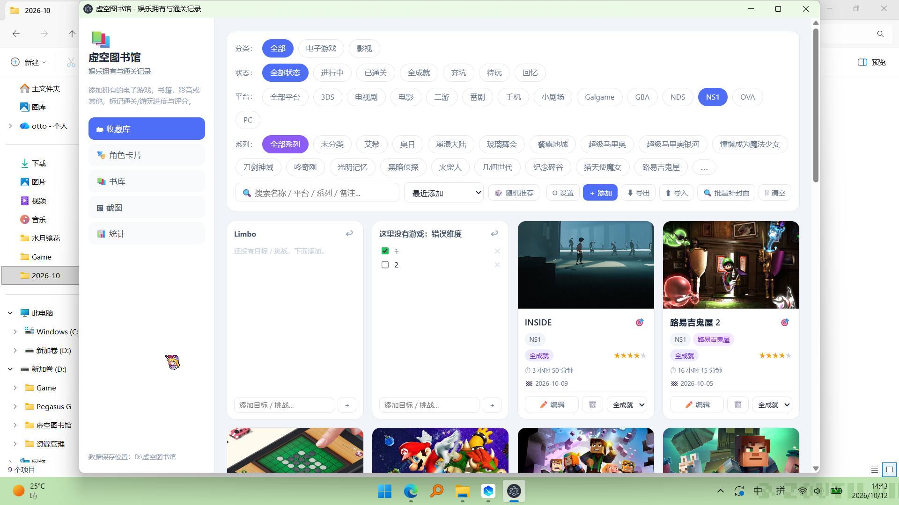
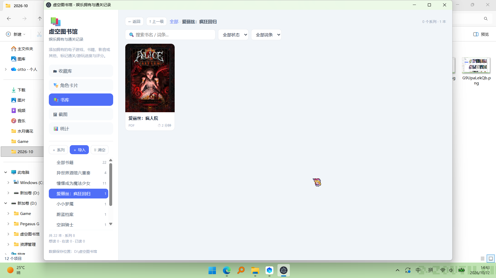
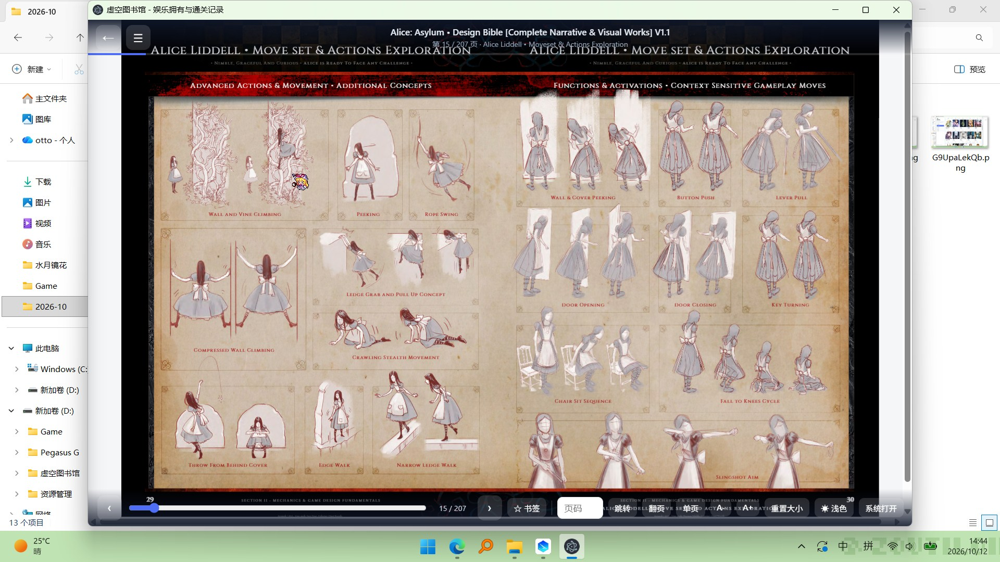
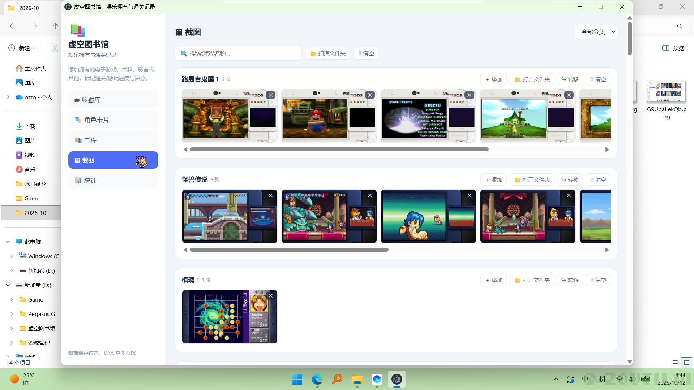
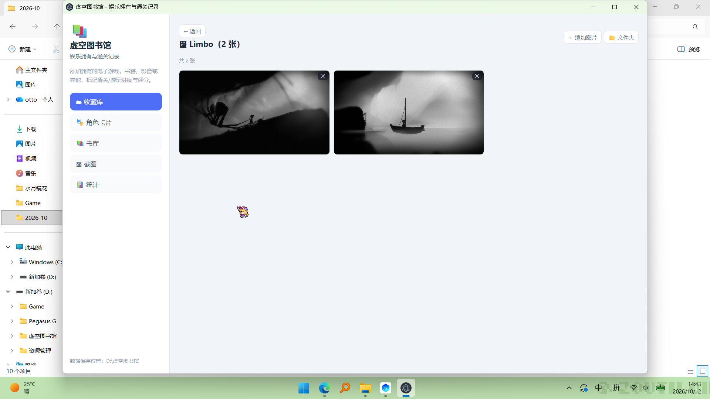
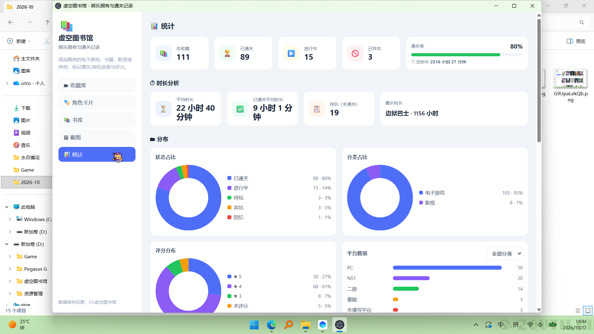

# 虚空图书馆

> 给喜欢的游戏、作品、角色与故事，一个值得长期保存的地方。

**虚空图书馆**是一款以本地收藏为核心的 Windows 桌面应用。你可以用它整理玩过或想玩的游戏、管理喜欢的角色和图片、建立自己的电子书书架，并通过统计回顾收藏与游玩经历。

它不仅是一份收藏清单，也是一座可以慢慢充实的个人数字图书馆。

> 下方图片为软件实际界面示例，展示内容来自个人收藏。

## ✨ 功能一览

| 功能 | 可以做什么 |
| --- | --- |
| 🗂️ **收藏库** | 记录游戏、影音等作品，管理分类、平台、系列、状态、评分、时长与封面 |
| 🎭 **角色卡片** | 收藏喜爱的角色，按作品整理角色图片与图集 |
| 📚 **书库** | 建立多级系列书架，阅读电子书、漫画和图片合集 |
| 🖼️ **截图** | 为作品保存截图，按游戏浏览、搜索和整理图片 |
| 📊 **统计** | 查看收藏总量、通关情况、游玩时长、评分分布与历史趋势 |

## 🗂️ 收藏库：为每一部作品留下记录

- **自由分类**：不限于电子游戏，也可以为影音、书籍或其他收藏创建分类。
- **详细信息**：保存名称、平台、系列、游玩状态、个人评分、游玩时长与完成日期。
- **灵活查找**：按照分类、状态、平台、系列筛选，通过关键词搜索和多种排序方式快速找到作品。
- **封面与截图**：手动添加封面和截图；封面支持拖拽定位、缩放和裁剪。
- **在线寻找封面**：可从 SteamGridDB、TMDB、Bangumi、VNDB 搜索作品与图片；还能为作品单独设置用于搜索的名称，不影响展示标题。
- **批量补全封面**：对没有封面的收藏批量搜索，支持选择来源、查看进度和停止任务。
- **随机推荐**：按自己的筛选条件随机抽取一部作品，帮助解决“接下来玩什么”的难题。

### 收藏筛选与分类

*按分类、状态、平台和系列筛选作品，快速找到自己想看的收藏。*

### 作品卡片展示

*封面卡片集中展示作品资料、游玩状态、评分和时长。*

## 🎭 角色卡片：收藏喜欢的角色

- 记录角色名字、所属作品与角色图片。
- 为每个角色建立独立图集，可逐张添加或从本地文件夹批量导入。
- 支持搜索角色和作品，并从 Bangumi、VNDB 等来源查询角色资料与图片。
- 支持按作品批量选择角色导入，以及通过浏览器查找更多角色图片。

*将角色图片、姓名和所属作品整理成便于浏览的卡片。*

## 📚 书库：整理并阅读自己的收藏

- **多级书架**：创建系列与子系列，将不同作品和卷册整理在一起。
- **书籍管理**：支持文件及文件夹导入、书名编辑、阅读状态、标签与系列移动，并可设置封面。
- **支持的主要内容**：EPUB、PDF、TXT、Markdown 文本、CBZ/ZIP 漫画以及图片文件夹等。
- **内置阅读器**：支持目录导航、翻页与滚动模式、单页/双页、字体与缩放调整、主题切换、页码跳转和恢复默认大小。
- **书签与进度**：添加、查看、跳转和删除书签，保存阅读位置与累计阅读时长。
- **其他打开方式**：需要时也可以使用系统关联的应用打开书籍。

### 书架与书籍管理

*通过系列书架整理电子书、PDF 和其他阅读资料。*

### 内置阅读器

*在应用内阅读 PDF 等文件，使用页码跳转、书签、单页或双页模式，以及字号与缩放控制。*

> **关于页码：** PDF 和漫画按文件页码定位；EPUB 等流式电子书使用阅读位置编号，可能不等于纸质书页码。

## 🖼️ 截图：保存值得回看的瞬间

- 将截图与对应作品关联，建立专属图片收藏。
- 支持添加多张图片、扫描文件夹，以及在图库中集中浏览。
- 按游戏筛选或搜索截图，方便回顾剧情、场景和游玩时刻。

### 游戏截图整理

*以作品为单位整理截图，支持横向查看、添加和打开原始文件夹。*

### 作品截图详情

*从收藏库进入作品图库，集中回顾同一部作品的截图。*

## 📊 统计：回顾自己的收藏旅程

- 收藏总数、已通关、进行中、已弃坑与通关率。
- 总游玩时长、平均时长、已通关作品平均时长及待玩数量。
- 分类、状态、评分和平台分布。
- 每月通关趋势、最近通关记录与最长时长作品。

*通过数据卡片和图表查看收藏状态、时长及分类分布。*

## 💾 本地数据与备份

虚空图书馆以本地数据为主，收藏记录、图片和书籍由自己管理。

- 支持导出收藏备份，也可以从 ZIP 或 JSON 备份导入记录。
- 导入前可以预览数据，并选择**追加到当前收藏**或**覆盖现有数据**。
- 追加模式按记录 ID 避免重复导入已有条目；覆盖模式适合完整恢复备份。
- 更换电脑或移动软件前，建议同时备份收藏记录和本地图片、书籍目录。

> **重要：** 备份 ZIP 不包含 `books/` 目录中的原始电子书文件。迁移或重装时，请另行备份并恢复 `books/` 文件夹。

## 🚀 开始使用

1. 打开虚空图书馆，在**收藏库**中添加第一部作品。
2. 前往**角色卡片**保存喜欢的角色与图片。
3. 在**书库**中创建系列，导入电子书或漫画开始阅读。
4. 使用**截图**与**统计**页面整理和回顾自己的收藏。
5. 定期通过**导出**保存备份。

**说明：** 此仓库保存的是应用源码，不包含个人收藏数据、书籍文件或私人 API Key。在线搜索功能需要联网，部分图片来源需要自行配置对应服务的 API Key。

---

**把热爱收进图书馆，让每一次游玩、阅读和相遇都有迹可循。**
